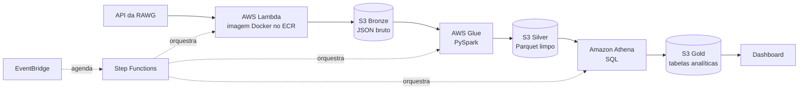

# 🎮 AWS Game Analysis

Pipeline de engenharia de dados que coleta, processa e analisa dados e avaliações de jogos da [RAWG](https://rawg.io/apidocs) usando **Python**, **SQL** e serviços **serverless da AWS**.

> 🚧 **Projeto em desenvolvimento.** O status de cada etapa está no [Roadmap](#-roadmap).

---

## 📌 Objetivo

Construir um pipeline em lote, de ponta a ponta, que transforma dados brutos de jogos em tabelas analíticas capazes de responder:

1. Jogos gratuitos são mais bem avaliados que os pagos?
2. Qual gênero é o mais bem avaliado entre os lançamentos recentes?
3. Quais desenvolvedoras e publicadoras têm a melhor média de avaliação?
4. Jogos gratuitos são mais abandonados que os pagos?
5. Quais gêneros estão perdendo espaço ao longo dos anos?
6. Em quais gêneros a crítica e os jogadores mais discordam?

## 🗂️ Fonte de dados

| Endpoint da RAWG | O que fornece | Frequência |
|---|---|---|
| `/games` | Gêneros, tags, nota dos usuários, quantidade de avaliações, Metacritic, status dos jogadores (jogando, zerado, abandonado...) e data de lançamento | Semanal (fotografia completa) |
| `/games/{id}` | Desenvolvedoras e publicadoras | Só para jogos novos ou atualizados |

### Limitações conhecidas

- As avaliações e os status refletem os usuários da RAWG, uma base menor e diferente das lojas.
- A tag *Free to Play* é atribuída pela comunidade e pode ter falhas.
- Os status de jogo (abandonado, zerado) são declarados pelos usuários, não medidos.

## 🏗️ Arquitetura

O projeto segue a **arquitetura medallion**, com os dados organizados em três camadas no Amazon S3:



| Camada | Conteúdo | Por quê |
|---|---|---|
| **Bronze** | JSON exatamente como veio da API | Permite reprocessar sem chamar a API de novo e serve de auditoria |
| **Silver** | Dados limpos, sem duplicatas, tipados, em Parquet | Fonte da verdade confiável para qualquer análise |
| **Gold** | Tabelas de negócio em esquema estrela | Respondem diretamente às perguntas do projeto e alimentam o dashboard |

### Principais decisões técnicas

- **Processamento em lote, não streaming:** as perguntas do projeto não exigem dados em tempo real, e uma coleta diária é suficiente e muito mais barata.
- **Serverless:** Lambda, Glue e Athena são cobrados por uso. Sem servidores ligados 24 horas, o custo do projeto fica próximo de zero.
- **Parquet particionado:** o Athena cobra pelo volume de dados lidos; o formato colunar e as partições reduzem drasticamente esse volume.
- **Lambda com imagem Docker:** o mesmo ambiente testado localmente vai para produção, sem depender do limite de tamanho do pacote zip da Lambda.
- **Fotografias semanais:** salvar a lista completa de jogos toda semana, particionada por data, cria um histórico próprio para analisar tendências.
- **Athena em vez de Redshift:** atende ao volume do projeto sem o custo de um data warehouse dedicado.

## 🧰 Tecnologias

| Categoria | Ferramentas |
|---|---|
| Linguagens | Python 3.13, SQL |
| Bibliotecas | requests, boto3, pandas, pyarrow |
| Armazenamento | Amazon S3 |
| Processamento | AWS Lambda, AWS Glue |
| Consulta | Amazon Athena, AWS Glue Data Catalog |
| Orquestração | Amazon EventBridge, AWS Step Functions |
| Contêineres | Docker, Docker Compose, Amazon ECR |
| Monitoramento | Amazon CloudWatch, Amazon SNS |

## 📁 Estrutura do projeto

```
aws-game-analysis/
├── ingestion/          # Coleta das APIs → camada bronze (Lambdas)
├── transformation/     # Jobs do Glue: bronze → silver
├── sql/                # DDL das tabelas e consultas da camada gold
├── infra/              # Definição da infraestrutura AWS
├── tests/              # Testes automatizados
├── docs/               # Diagramas, prints e documentação
├── Dockerfile          # Ambiente de desenvolvimento
├── docker-compose.yml  # Sobe o ambiente local
├── requirements.txt    # Dependências Python com versões fixas
├── .env                # Configurações locais (não versionado)
├── .gitignore
└── .dockerignore
```

## 🚀 Como rodar localmente

### Pré-requisitos

- [Docker Desktop](https://www.docker.com/products/docker-desktop/) (no Windows, com WSL2 ativado)
- [AWS CLI v2](https://docs.aws.amazon.com/cli/latest/userguide/getting-started-install.html)
- Uma conta AWS com um usuário IAM e chave de acesso

### Passo a passo

1. **Clone o repositório**

   ```bash
   git clone <url-do-repositorio>
   cd aws-game-analysis
   ```

2. **Configure as credenciais da AWS na sua máquina**

   ```bash
   aws configure
   ```

   As credenciais ficam na pasta `~/.aws`, que é montada no contêiner apenas para leitura. Elas nunca entram na imagem nem no repositório.

3. **Crie o arquivo `.env`** na raiz do projeto (pode começar vazio).

4. **Suba o ambiente**

   ```bash
   docker compose up -d --build
   ```

5. **Entre no contêiner**

   ```bash
   docker compose exec dev bash
   ```

6. **Teste a conexão com a AWS**

   ```bash
   python -c "import boto3; print(boto3.client('sts').get_caller_identity())"
   ```

   A resposta deve mostrar o ARN do seu usuário IAM.

Para desligar o ambiente:

```bash
docker compose down
```

## 🔐 Segurança

- Credenciais da AWS ficam apenas em `~/.aws` na máquina local.
- O `.env` está no `.gitignore` e no `.dockerignore`, então não vai para o GitHub nem para a imagem.
- A chave da API da RAWG fica no `.env` localmente e em variável de ambiente na Lambda, nunca no código.
- O pipeline usa um usuário IAM dedicado, nunca a conta root.

## 🗺️ Roadmap

- [x] Definir objetivo, fontes de dados e arquitetura
- [x] Ambiente de desenvolvimento com Docker
- [x] Configuração da conta AWS (orçamento, buckets S3, ECR, IAM)
- [ ] Ingestão da API da RAWG → bronze
- [ ] Transformação com Glue → silver
- [ ] Modelagem em esquema estrela e tabelas gold no Athena
- [ ] Orquestração com Step Functions e EventBridge
- [ ] Validações de qualidade de dados e monitoramento
- [ ] Dashboard
- [ ] CI/CD com GitHub Actions
- [ ] Infraestrutura como código

## 💰 Custos

O projeto é desenhado para ter custo mínimo: serviços cobrados por uso, dados em Parquet particionado e um alerta de orçamento configurado no AWS Budgets.

## 👤 Autor

**Matheus** — [LinkedIn](#) · [GitHub](#)
