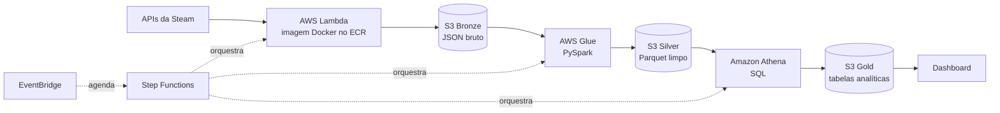

# 🎮 AWS Game Analysis

Pipeline de engenharia de dados que coleta, processa e analisa avaliações de jogos da Steam usando **Python**, **SQL** e serviços **serverless da AWS**.

> 🚧 **Projeto em desenvolvimento.** O status de cada etapa está no [Roadmap](#-roadmap).

---

## 📌 Objetivo

Construir um pipeline em lote, de ponta a ponta, que transforma avaliações brutas de jogos em tabelas analíticas capazes de responder perguntas como:

- Quais jogos têm grande diferença entre as avaliações recentes e as históricas (sinal de *review bombing* ou de uma atualização marcante)?
- O tempo de jogo do autor influencia se a avaliação é positiva?
- Como o sentimento das avaliações evolui após um lançamento ou atualização?
- Quais gêneros têm melhor avaliação por faixa de preço?

## 🗂️ Fontes de dados

| Fonte | O que fornece |
|---|---|
| API de reviews da Steam | Texto da avaliação, recomendação, horas jogadas e data |
| API da Steam Store (appdetails) | Gênero, preço, desenvolvedora e data de lançamento |

## 🏗️ Arquitetura

O projeto segue a **arquitetura medallion**, com os dados organizados em três camadas no Amazon S3:



| Camada | Conteúdo | Por quê |
|---|---|---|
| **Bronze** | JSON exatamente como veio da API | Permite reprocessar sem chamar a API de novo e serve de auditoria |
| **Silver** | Dados limpos, sem duplicatas, tipados, em Parquet | Fonte da verdade confiável para qualquer análise |
| **Gold** | Tabelas de negócio em esquema estrela | Respondem diretamente às perguntas do projeto e alimentam o dashboard |

### Principais decisões técnicas

- **Processamento em lote, não streaming:** as perguntas do projeto não exigem dados em tempo real, e uma coleta diária é suficiente e muito mais barata.
- **Serverless:** Lambda, Glue e Athena são cobrados por uso. Sem servidores ligados 24 horas, o custo do projeto fica próximo de zero.
- **Parquet particionado:** o Athena cobra pelo volume de dados lidos; o formato colunar e as partições reduzem drasticamente esse volume.
- **Lambda com imagem Docker:** as dependências (pandas, pyarrow e bibliotecas de NLP) podem ultrapassar o limite do pacote zip da Lambda.
- **Athena em vez de Redshift:** atende ao volume do projeto sem o custo de um data warehouse dedicado.

## 🧰 Tecnologias

| Categoria | Ferramentas |
|---|---|
| Linguagens | Python 3.13, SQL |
| Bibliotecas | requests, boto3, pandas, pyarrow |
| Armazenamento | Amazon S3 |
| Processamento | AWS Lambda, AWS Glue |
| Consulta | Amazon Athena, AWS Glue Data Catalog |
| Orquestração | Amazon EventBridge, AWS Step Functions |
| Contêineres | Docker, Docker Compose, Amazon ECR |
| Monitoramento | Amazon CloudWatch, Amazon SNS |

## 📁 Estrutura do projeto

```
aws-game-analysis/
├── ingestion/          # Coleta das APIs → camada bronze (Lambdas)
├── transformation/     # Jobs do Glue: bronze → silver
├── sql/                # DDL das tabelas e consultas da camada gold
├── infra/              # Definição da infraestrutura AWS
├── tests/              # Testes automatizados
├── docs/               # Diagramas, prints e documentação
├── Dockerfile          # Ambiente de desenvolvimento
├── docker-compose.yml  # Sobe o ambiente local
├── requirements.txt    # Dependências Python com versões fixas
├── .env                # Configurações locais (não versionado)
├── .gitignore
└── .dockerignore
```

## 🚀 Como rodar localmente

### Pré-requisitos

- [Docker Desktop](https://www.docker.com/products/docker-desktop/) (no Windows, com WSL2 ativado)
- [AWS CLI v2](https://docs.aws.amazon.com/cli/latest/userguide/getting-started-install.html)
- Uma conta AWS com um usuário IAM e chave de acesso

### Passo a passo

1. **Clone o repositório**

   ```bash
   git clone <url-do-repositorio>
   cd aws-game-analysis
   ```

2. **Configure as credenciais da AWS na sua máquina**

   ```bash
   aws configure
   ```

   As credenciais ficam na pasta `~/.aws`, que é montada no contêiner apenas para leitura. Elas nunca entram na imagem nem no repositório.

3. **Crie o arquivo `.env`** na raiz do projeto (pode começar vazio).

4. **Suba o ambiente**

   ```bash
   docker compose up -d --build
   ```

5. **Entre no contêiner**

   ```bash
   docker compose exec dev bash
   ```

6. **Teste a conexão com a AWS**

   ```bash
   python -c "import boto3; print(boto3.client('sts').get_caller_identity())"
   ```

   A resposta deve mostrar o ARN do seu usuário IAM.

Para desligar o ambiente:

```bash
docker compose down
```

## 🔐 Segurança

- Credenciais da AWS ficam apenas em `~/.aws` na máquina local.
- O `.env` está no `.gitignore` e no `.dockerignore`, então não vai para o GitHub nem para a imagem.
- O pipeline usa um usuário IAM dedicado, nunca a conta root.

## 🗺️ Roadmap

- [x] Definir objetivo, fontes de dados e arquitetura
- [x] Ambiente de desenvolvimento com Docker
- [ ] Configuração da conta AWS (orçamento, buckets S3, ECR, IAM)
- [ ] Ingestão incremental das APIs da Steam → bronze
- [ ] Transformação com Glue → silver
- [ ] Modelagem em esquema estrela e tabelas gold no Athena
- [ ] Orquestração com Step Functions e EventBridge
- [ ] Validações de qualidade de dados e monitoramento
- [ ] Dashboard
- [ ] Análise de sentimento das avaliações
- [ ] CI/CD com GitHub Actions
- [ ] Infraestrutura como código

## 💰 Custos

O projeto é desenhado para ter custo mínimo: serviços cobrados por uso, dados em Parquet particionado e um alerta de orçamento configurado no AWS Budgets.